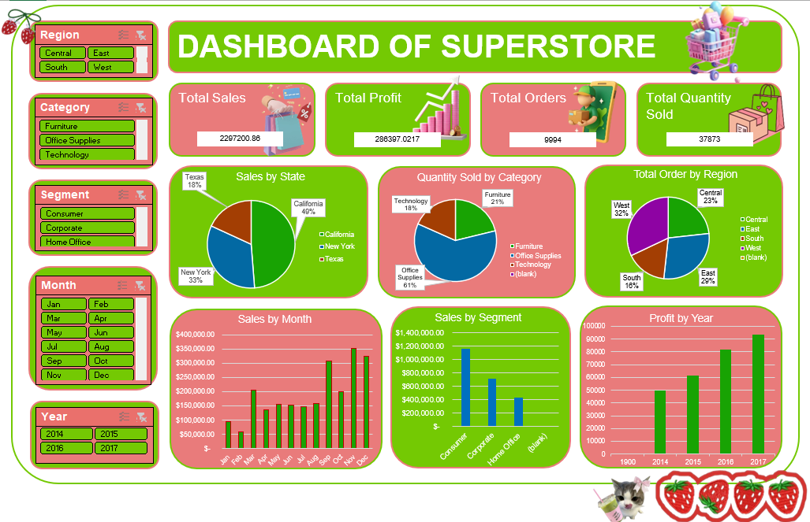

# Superstore Sales Monitoring Dashboard - Excel

## Overview
Interactive Excel dashboard built from Superstore dataset (9,994 orders) to provide real-time monitoring of sales performance, profitability, and customer trends. This project complements the PCA analysis by translating statistical findings into actionable business visualization.

  

## Dataset
- Source: Superstore Sales Dataset
- Records: 9,994 orders
- Variables: Sales, Profit, Quantity, Discount, Category, Region, Customer Segment
- Period: 2014-2017

## Tools Used
- Microsoft Excel
- PivotTable & PivotChart
- Slicers & Timeline
- Conditional Formatting
- KPI Cards

## Dashboard Features

### 1. KPI Monitoring
- Total Sales
- Total Profit
- Profit Ratio
- Total Quantity

### 2. Sales Performance Analysis
- Sales by Category (Furniture, Office Supplies, Technology)
- Sales by Region (West, East, Central, South)
- Sales Trend by Year

### 3. Profitability Insights
- Profit by Category
- Discount impact on Profit

### 4. Interactive Controls
- Year filter (Slicer)
- Category filter
- Region filter

## Key Business Insights

1.  **Technology category generates highest sales** but requires monitoring of profit margin due to discount strategy.
2.  **West region leads in sales volume**, indicating strong market penetration opportunity for other regions.
3.  **Discounting strategy shows trade-off** - excessive discount increases quantity but reduces profit, aligning with PCA finding on PC3 (Margin Trade-off component).

## Files in this Repository
- `dashboard.png` - Dashboard preview
- `superstore-dataset-dashboard.xlsx` - Interactive Excel dashboard file

## Future Enhancement
- Migrate to Power BI for automated data refresh
- Add customer segmentation analysis
